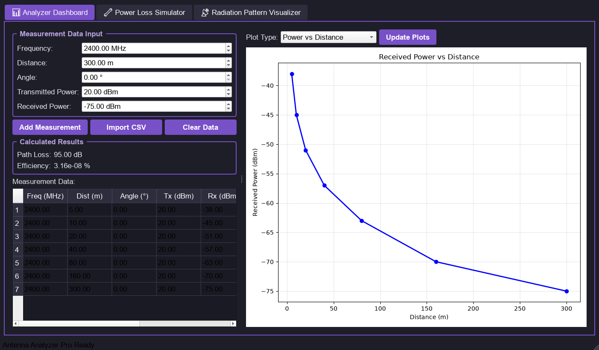
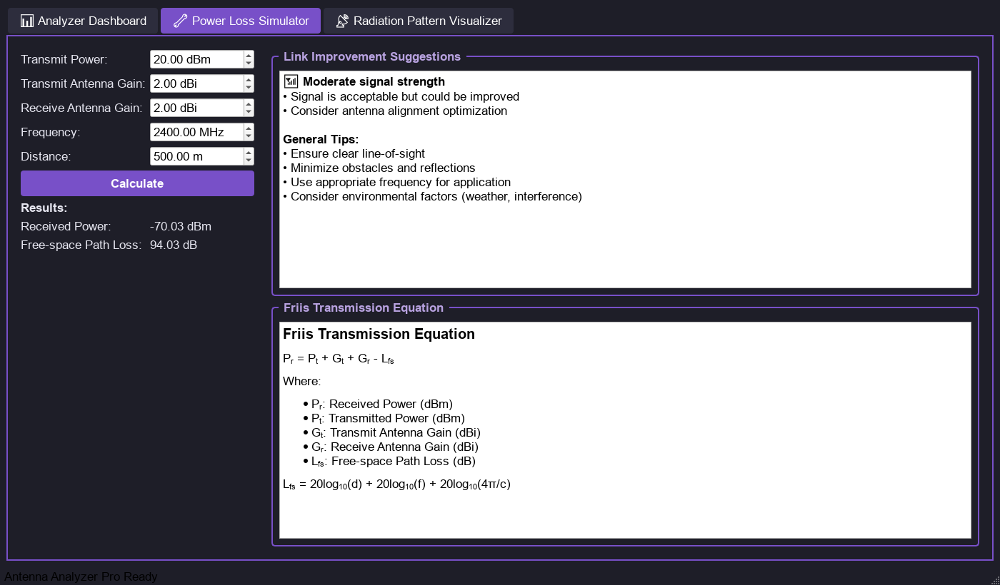
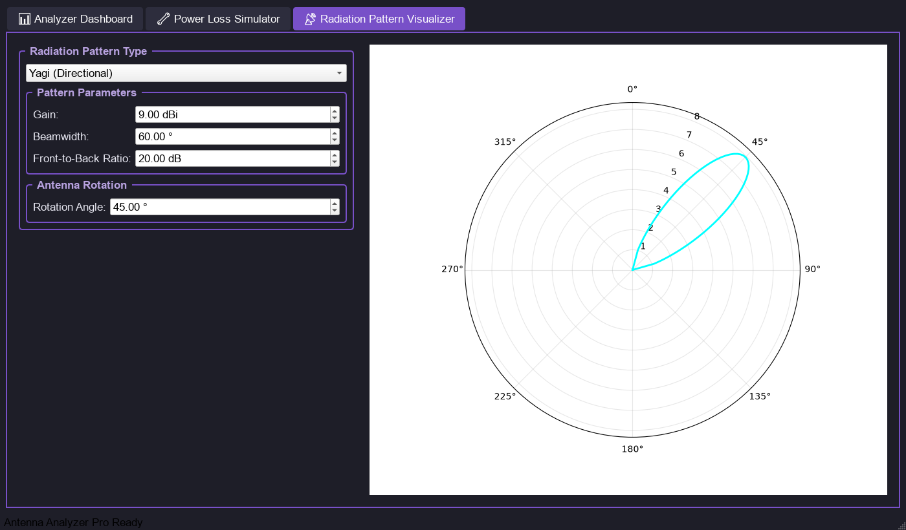

# Antenna Analyzer Pro

A desktop toolkit for **antenna and RF link analysis**, built with **Python, PyQt5 and Matplotlib**.
Log and plot field measurements, compute a free-space link budget with the Friis equation, and
visualise antenna radiation patterns, all in one dark-themed app.



## Features

### 📊 Analyzer Dashboard
- Enter measurements (frequency, distance, angle, transmitted and received power) or **import them from CSV**
- Automatic path-loss and power-transfer calculation for every measurement
- Interactive plots: received power vs distance, angle or frequency, and path loss vs frequency

### 🔧 Power Loss Simulator
- **Friis transmission equation** link budget: received power and free-space path loss from
  transmit power, antenna gains, frequency and distance
- Signal-strength assessment with **link improvement suggestions**, for example how many dB
  you gain by halving the distance



### 📡 Radiation Pattern Visualizer
- Polar plots of omnidirectional, dipole, Yagi (directional) and parabolic antenna patterns
- Adjustable gain, beamwidth, front-to-back ratio and antenna rotation
- Import measured angle/gain data from CSV



## The physics

Received power (Friis, in dB):

```
Pr = Pt + Gt + Gr − Lfs
Lfs = 20·log10(d) + 20·log10(f) + 20·log10(4π / c)
```

where `Pt` is transmit power (dBm), `Gt`/`Gr` are antenna gains (dBi), `d` is distance (m), `f` is
frequency (Hz) and `c` is the speed of light.

## Getting started

Requires Python 3.9+.

```bash
git clone https://github.com/ahmedayadeng-lang/antenna-analyzer-pro.git
cd antenna-analyzer-pro
pip install -r requirements.txt
python antenna_analyzer.py
```

## CSV formats

**Measurements** (Analyzer Dashboard → Import CSV): one row per measurement with a header row and
five columns in this order:

```csv
frequency_mhz,distance_m,angle_deg,tx_power_dbm,rx_power_dbm
2400,10,0,20,-45
2400,20,0,20,-51
```

**Radiation pattern** (Custom Import): two columns, angle in degrees and gain in dBi:

```csv
angle_deg,gain_dbi
0,8.0
5,7.9
```

## Tech stack

Python · PyQt5 · Matplotlib · NumPy · pandas
